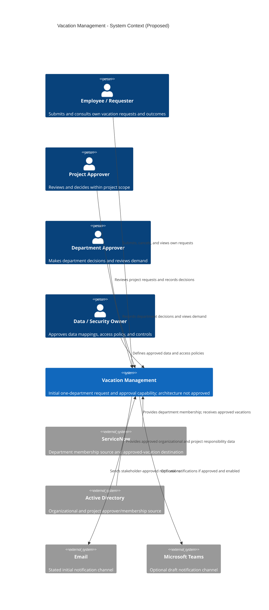
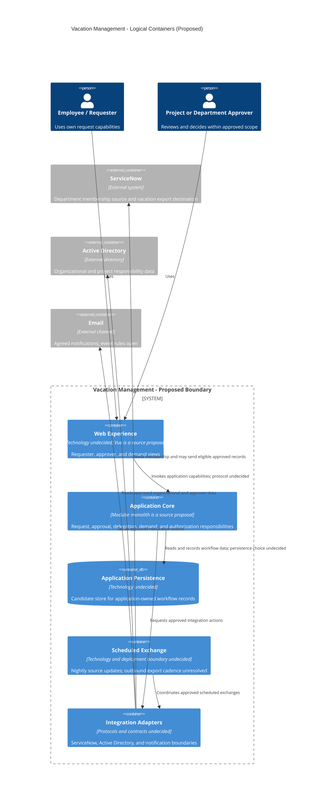
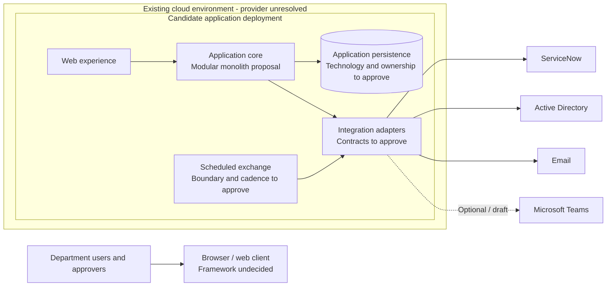

# Vacation Management: Solution Architecture

**Status:** Architecture proposal; not an approved project baseline.
**Prepared:** 2026-10-08
**Scope:** Initial one-department vacation request, review, approval, demand visibility, notification, and integration capabilities.

## Decision Status

The requirements baseline is marked Draft, the RFP is marked Draft, and the project constitution is an unratified template. The baseline explicitly says the source architecture is not approved. This document therefore distinguishes discovery evidence from proposed architecture; it must not be used as an approved deployment or implementation decision.

| Status label            | Meaning in this document                                                                                       |
| ----------------------- | -------------------------------------------------------------------------------------------------------------- |
| **Discovery-confirmed** | Explicitly stated in discovery and recorded as confirmed in the baseline. This is not formal project approval. |
| **Proposal**            | Architecture direction or control to evaluate; not a binding decision.                                         |
| **Unresolved**          | A source question prevents a defensible design choice or acceptance target.                                    |

## Context and Actors

The system supports vacation requests and review within the initial department scope, with project- and department-level approver decisions. It depends on organizational information and integrates with ServiceNow and Active Directory. Email is the stated initial notification channel. The architecture and interface contracts remain proposals or unresolved.

| Actor / system                  | Role in the context                                                                                          | Evidence status                                                                                                        |
| ------------------------------- | ------------------------------------------------------------------------------------------------------------ | ---------------------------------------------------------------------------------------------------------------------- |
| Employee / requester            | Submit or cancel own request where permitted; view own outcomes and history; receive approved notifications. | Discovery-confirmed capabilities, with request fields, lifecycle, access rules, and notification semantics unresolved. |
| Project approver                | Review project-associated requests, approve or reject, and delegate within the same project if authorized.   | Project approval and same-project delegation are stated; mapping, permissions, and detailed policy remain unresolved.  |
| Department approver             | Record department-level approval and view department demand.                                                 | Discovery-confirmed capability; approver assignment, decision relationship, and count semantics unresolved.            |
| Application/security owner      | Define identity, role/action access, data boundary, and security requirements.                               | Required stakeholder responsibility; identity and controls are not yet approved.                                       |
| Data/integration owner          | Confirm authoritative data, mappings, interface contracts, cadence, and failure handling.                    | Required for the named ServiceNow and Active Directory exchanges; ownership details unresolved.                        |
| Vacation Management application | Maintain the workflow and expose decisions to related processes.                                             | Business need confirmed; application data ownership and implementation are proposals.                                  |
| ServiceNow                      | Source of department membership information and destination for approved vacation records.                   | Named in discovery; exact records, interfaces, data ownership, and export eligibility are unresolved.                  |
| Active Directory                | Source of organizational and project approver/membership information.                                        | Named in discovery; authoritative attributes and relationships are unresolved.                                         |
| Email                           | Deliver agreed user notifications and alarms.                                                                | Channel stated; events, recipients, content, delivery behavior, and retention are unresolved.                          |
| Microsoft Teams                 | Possible optional notification channel.                                                                      | Draft/optional; not a baseline dependency.                                                                             |
| “my scaturing”                  | Possible source for preloading or validation.                                                                | Unconfirmed transcription and draft candidate; excluded from the proposed initial context.                             |

### System Context Diagram

The diagram shows discovery-named actors and external systems. Relationships are capability-level only; no protocol or approved interface is implied.

Diagram source: [vacation-management-c4-context.mmd](../../diagrams/vacation-management-c4-context.mmd).

## Architecture Drivers

| Driver                                                                              | Source status                                                                                                                | Architecture implication                                                                                                                       |
| ----------------------------------------------------------------------------------- | ---------------------------------------------------------------------------------------------------------------------------- | ---------------------------------------------------------------------------------------------------------------------------------------------- |
| Support vacation requests and project/department approval.                          | Discovery-confirmed business need; workflow rules remain open.                                                               | Separate request lifecycle from approval policy; do not assume decision order or finality.                                                     |
| Initial use is for one department.                                                  | Discovery-confirmed scope (TC-002); exact boundary and enforcement are unresolved.                                           | Make the department scope explicit in access and data mapping. Whether isolation must be enforced technically requires approval.               |
| Integrate with ServiceNow and Active Directory.                                     | Named systems and interactions are discovery-confirmed; contracts are unresolved.                                            | Isolate external-system access behind integration boundaries. Protocol, schema, authentication, and reconciliation remain ADR inputs.          |
| Nightly updates are sufficient; real-time synchronization is not required.          | Discovery-confirmed freshness direction (NFR-007/TC-006); data sets and schedule unresolved.                                 | A scheduled exchange is a viable proposal; do not extend this cadence to outbound export or notifications without approval.                    |
| Stated capacity is 500 users at a time.                                             | In baseline, but concurrency meaning, workload, and response/error targets are unresolved (NFR-001).                         | Validate load and scaling after the target profile is clarified; do not claim capacity from a topology alone.                                  |
| Usage is seasonal and low-use cost should be controlled.                            | Discovery-confirmed objectives; peak profile and budget are unresolved (BR-006/BR-007, NFR-005/NFR-006).                     | Prefer a deployment model that can be sized for peaks and reviewed for low-period cost; specific scaling and cost mechanisms require evidence. |
| Approver views and calendars should be simple and readable.                         | Discovery-confirmed qualitative needs; measurable usability/accessibility criteria unresolved (NFR-002 to NFR-004, NFR-008). | Include task-based usability and supported-device criteria in acceptance planning; no UI framework is selected.                                |
| Authentication, authorization, privacy, and compliance are necessary design inputs. | Authentication/RBAC are proposals (SEC-001/SEC-002); obligations are not established (SEC-003).                              | Resolve identity, authorization, audit, data handling, and compliance before production approval.                                              |

## Logical Components

The following componentization is a proposal based partly on the unapproved source architecture. It is logical separation, not a decision to deploy each component independently.

| Logical component          | Responsibility                                                                                                                | Status / boundary                                                                                                                                          |
| -------------------------- | ----------------------------------------------------------------------------------------------------------------------------- | ---------------------------------------------------------------------------------------------------------------------------------------------------------- |
| Web experience             | Requester views; approver review, decision, and demand views.                                                                 | Web access is implied by the application-link need. Vue is a source proposal only; supported clients and UX criteria are unresolved.                       |
| Application core           | Request lifecycle, approval decisions/delegation, demand queries, and authorization checks at the application boundary.       | Proposed modular monolith; domain ownership spans F-001 to F-004 and needs refinement. Request-state and approval rules are unresolved.                    |
| Persistence                | Store application-owned requests, decisions, and workflow data.                                                               | Persistence is in the source architecture proposal; database technology, ownership, retention, and consistency are not selected.                           |
| Integration adapters       | Translate agreed ServiceNow, Active Directory, and email contracts at system boundaries.                                      | Adapter boundary is a proposal; products, protocols, schemas, and credentials are unresolved. Teams remains optional/draft.                                |
| Scheduled exchange         | Retrieve agreed membership/organizational updates on an approved nightly schedule; coordinate any separately approved export. | Scheduled processing is proposed and nightly updates are stated; exact job boundary, schedule, export cadence, retries, and reconciliation are unresolved. |
| Observability capabilities | Record service health, workflow/integration outcomes, and operational diagnostics.                                            | Necessary architecture capability proposed; telemetry platform, audit scope, SLOs, and retention are unresolved.                                           |

### Logical Container Diagram

The application and persistence components are candidates. External interfaces and technology labels are intentionally left unselected.

Diagram source: [vacation-management-c4-containers.mmd](../../diagrams/vacation-management-c4-containers.mmd).

## Deployment View

**Proposal only:** deploy the web experience, application core, persistence, and scheduled exchange within the existing cloud environment, with the provider and service model selected by ADR. A first release could co-host scheduled processing with the application if operational isolation and scale testing permit; separate deployment is an option, not a requirement.

The baseline names Azure and Amazon as cloud options and says Azure is available, not selected. The constitution says “Azure mandatory” but has status `Template` and blank ratification fields. This conflict must be resolved; this document does not treat Azure as an approved provider. No region, network topology, compute service, database, secrets service, or environment promotion strategy is selected.

Diagram source: [vacation-management-deployment-view.mmd](../../diagrams/vacation-management-deployment-view.mmd).

Deployment responsibilities, network/security zones, availability zones, scaling controls, backups, and disaster recovery are unresolved. The diagram must not be read as an approved cloud topology.

## Data Ownership

| Data                                              | Source/owner evidenced in discovery                                                                                                                  | Proposed application responsibility                                                                                                                      | Unresolved ownership questions                                                                                     |
| ------------------------------------------------- | ---------------------------------------------------------------------------------------------------------------------------------------------------- | -------------------------------------------------------------------------------------------------------------------------------------------------------- | ------------------------------------------------------------------------------------------------------------------ |
| Department membership                             | ServiceNow is named as the membership source (INT-001).                                                                                              | Consume a mapped membership snapshot for scoped capabilities.                                                                                            | Exact table/API, identifiers, authoritative owner, refresh and conflict handling.                                  |
| Organization/project approver and membership data | Active Directory is named for organizational and project approver information (TC-004, INT-002/003); project relationship meaning is open (INT-004). | Consume only mapped attributes needed for request routing and scoped review.                                                                             | Hierarchy conflict, source-of-truth boundaries, membership versus reporting relationships, cardinality, freshness. |
| Vacation requests                                 | Employee submission is a requested capability; no external request system is specified.                                                              | **Proposal:** application persistence owns request records and lifecycle.                                                                                | Request fields, edit/cancel rules, lifecycle, retention, and whether any legacy system owns records.               |
| Approval decisions and delegation records         | F-002 requires recording level decisions and same-project delegation; no storage system is specified.                                                | **Proposal:** application persistence owns decision/delegation records and actor attribution required by approved policy.                                | Decision cardinality/finality, correction, audit evidence, identity references, retention.                         |
| Demand views and counts                           | Derived from membership and request data; calculation is not defined.                                                                                | **Proposal:** calculate from source-owned membership plus application workflow data; avoid a separate source of truth unless scale evidence requires it. | Counted states, denominator, period boundaries, hierarchy, freshness.                                              |
| Exported approved vacations                       | ServiceNow is the destination (INT-005/006).                                                                                                         | Send only records satisfying the approved required-approval rule.                                                                                        | Finality, payload ownership, acknowledgement, duplicates, correction and reconciliation.                           |
| Notifications                                     | Email is a stated channel; message content/events are open.                                                                                          | Send only from agreed domain/workflow events.                                                                                                            | Recipient, event, delivery/audit retention, data minimization, Teams policy.                                       |

## Integration Contracts

No protocol, schema, authentication method, endpoint, SLA, retry policy, or acknowledgement contract is approved. The architecture proposal is to isolate each system behind a versioned adapter/contract and agree ownership with its system owner before implementation.

| Integration                | Direction and known purpose                                                                               | Confirmed vs proposal                                                                                           | Contract items requiring decision                                                                                                           |
| -------------------------- | --------------------------------------------------------------------------------------------------------- | --------------------------------------------------------------------------------------------------------------- | ------------------------------------------------------------------------------------------------------------------------------------------- |
| ServiceNow membership      | Inbound department membership data.                                                                       | Source system and need are discovery-confirmed (INT-001). Adapter and batch exchange are proposals.             | Product/API or file interface, department key, fields, schedule, freshness, authentication, pagination, errors, reconciliation.             |
| Active Directory           | Inbound organization, project approver, and project membership data.                                      | Directory source is named; INT-003 project approver identity is confirmed in discovery.                         | Product/interface, attributes, mapping/cardinality, membership semantics, access rights, schedule, stale/missing/conflicting data behavior. |
| ServiceNow vacation export | Outbound approved vacation records, excluding any record missing a stakeholder-defined required approval. | Destination and approved-only rule are discovery-confirmed (INT-005/006); export gate details unresolved.       | Required approvers/finality, trigger/cadence, payload, acknowledgement, idempotency, failure/replay/reconciliation, source correction.      |
| Email                      | Outbound approved notification events.                                                                    | Email is the stated initial channel (INT-007); event list, recipients, content, timing, reliability unresolved. | Event definitions, final-approval trigger, recipient resolution, links/content, retry/duplicate behavior, retention/audit.                  |
| Microsoft Teams            | Potential outbound notification channel.                                                                  | Optional/draft (INT-008); not a required dependency.                                                            | Whether enabled, user/event opt-in, content, links, identity mapping, failure and retention.                                                |
| “my scaturing”             | Possible inbound preload/validation interaction.                                                          | Unconfirmed/draft (INT-010); excluded from initial integration architecture.                                    | Correct system name, owner, purpose, and whether the capability is in scope.                                                                |

Nightly update download is stated as sufficient instead of real-time synchronization (NFR-007/TC-006); this does not settle which system/data flow uses that cadence. Do not assume the ServiceNow export shares the update schedule.

## Identity and Authorization

**Confirmed need:** request, approval, and demand capabilities require identifying actors and enforcing scoped access. **Not confirmed:** authentication provider/protocol and approved role/action policy.

| Concern            | Current evidence                                                                                 | Architecture position                                                                                                                                     |
| ------------------ | ------------------------------------------------------------------------------------------------ | --------------------------------------------------------------------------------------------------------------------------------------------------------- |
| Authentication     | SEC-001 is a draft proposal only.                                                                | Identity source and protocol are unresolved. Keep identity provider replaceable; do not select a provider here.                                           |
| Roles              | Requester, project approver, department approver, and delegate are described in feature sources. | Role names are domain actors, not an approved access matrix. Define permitted actions, assignment, revocation, and multi-role behavior before acceptance. |
| Scope              | Initial use is one department; project and department scopes are used by workflow features.      | Enforce only stakeholder-approved department/project boundaries. Exact isolation and cross-project behavior remain unresolved.                            |
| Delegation         | Same-project delegation is stated; actor attribution is conditional on audit policy.             | Validate delegator, delegate, and scope against approved policy; duration, approval, revocation, and attribution rules require decisions.                 |
| Service identities | Integration reads and writes are required.                                                       | Credential type, privilege scope, rotation, and ownership are not specified; require least-privilege design in the identity ADR.                          |

The constitution template contains Azure identity/security options and a TLS 1.2+ statement, but its status is `Template` and it is not ratified. These statements are not treated as approved F-002 or project controls here.

## Observability

No observability stack, operational ownership, SLI/SLO, alert threshold, or retention target is selected. NFR-001/NFR-005 describe capacity and seasonal usage but do not provide measurable acceptance targets.

**Proposal for review:** capture service health and request/decision outcomes; integration run status, freshness, record counts, failures, retries, and reconciliation; notification delivery outcomes; and latency/error/throughput signals needed to validate the later-approved load profile. Provide correlation across a request and its decision/integration events without putting vacation details or unnecessary personal data into logs. Define audit records separately from diagnostic logs.

Azure Monitor, Application Insights, OpenTelemetry, and other tools are not selected. The constitution lists them as options in an unratified template.

## Resilience

The source baseline does not define availability, recovery, retry, idempotency, queueing, or reconciliation targets. Resilience behavior below is proposed and requires per-integration contract decisions:

- Treat ServiceNow/Active Directory unavailability as a visible incomplete or stale-data condition; do not silently present unverified membership or approver mappings as current.
- Make scheduled exchanges observable and safely repeatable after their duplicate/idempotency contract is agreed.
- Reconcile inbound snapshots and outbound records against an agreed source/destination reference; define ownership for rejected or conflicting records.
- Avoid marking an approval/export/notification successful until its required persistence or delivery acknowledgement is defined and observed.
- Choose retry limits, backoff, dead-letter/manual-recovery behavior, timeout, and circuit isolation only after system owners specify interface semantics and operational targets.
- Define backup, restore, recovery time, and recovery point objectives before production deployment; no current target exists.

These are design recommendations, not committed behavior or service guarantees.

## Security and Compliance

SEC-001 and SEC-002 are draft architecture proposals; SEC-003 says applicable security, privacy, and compliance obligations have not been established. No regulatory certification or compliance status can be claimed.

| Area                                        | Evidence status                                                                                                                     | Required decision / proposal                                                                                                        |
| ------------------------------------------- | ----------------------------------------------------------------------------------------------------------------------------------- | ----------------------------------------------------------------------------------------------------------------------------------- |
| Personal/organizational data classification | Unresolved (SEC-003).                                                                                                               | Identify data categories, allowed purposes, minimization, retention, deletion, and data-owner approval.                             |
| Authentication and scoped authorization     | Draft proposals (SEC-001/SEC-002).                                                                                                  | Approve identity population, role/action matrix, department isolation, project scope, delegate privileges, and denied-access tests. |
| Encryption and network boundaries           | No approved project-level control identified. Constitution template includes TLS 1.2+ and Azure network options, but is unratified. | Approve in-transit/at-rest protections, key ownership, external ingress/egress, and private connectivity requirements.              |
| Secrets and service credentials             | Not specified by approved project sources.                                                                                          | Select credential storage, service identity, least privilege, rotation, and access review.                                          |
| Audit                                       | Decision/delegation attribution is unresolved (F-002, Q-022).                                                                       | Define decision, delegation, access, integration, export, and administrative audit events plus retention and review ownership.      |
| Compliance                                  | No standard or regulatory scope established (SEC-003).                                                                              | Security/privacy owner records applicable obligations or explicitly confirms none apply before production acceptance.               |

## Alternatives and Trade-offs

| Decision area         | Alternative                                           | Benefits                                                                                  | Costs / risks                                                                                                                 | Current position                                                                     |
| --------------------- | ----------------------------------------------------- | ----------------------------------------------------------------------------------------- | ----------------------------------------------------------------------------------------------------------------------------- | ------------------------------------------------------------------------------------ |
| Application style     | Modular monolith with internal capability boundaries. | Matches the source proposal; simpler initial operations and coordinated workflow changes. | Shared deployment/scaling boundary; disciplined module ownership is needed.                                                   | **Proposal only**, not accepted.                                                     |
| Application style     | Microservices by feature or integration.              | Independent deployment/scaling and failure isolation may help if ownership/scale diverge. | More operational, network, consistency, and observability complexity; no independent team/service requirements are evidenced. | Defer unless validated drivers justify it.                                           |
| Synchronization       | Scheduled/batch updates.                              | Aligns with the stated sufficiency of nightly updates and seasonal/cost objectives.       | Data may be stale between runs; failure detection and reconciliation matter.                                                  | Nightly updates are discovery-confirmed; exact schedules and export timing are open. |
| Synchronization       | Real-time/event-driven updates.                       | Lower data staleness where a workflow genuinely requires it.                              | Greater coupling, availability, and delivery complexity; no real-time requirement is stated.                                  | Not required by current discovery; retain only if clarified.                         |
| Cloud                 | Existing Azure environment.                           | Azure is stated to be available; constitution template also names Azure.                  | Availability is not selection; constitution mandate conflicts with baseline and is unratified.                                | Provider decision required; not selected.                                            |
| Cloud                 | Existing AWS/Amazon environment.                      | Named as an option in the source technical constraint.                                    | No approval, service mapping, or operational evidence establishes it as selected.                                             | Provider decision required; not selected.                                            |
| Integration transport | System-owner-approved API contract.                   | Can support explicit request/response and near-current reads where needed.                | Interface availability, rate limits, identity, and pagination must be agreed.                                                 | Candidate only; product/protocol unspecified.                                        |
| Integration transport | Scheduled file/batch exchange.                        | Fits nightly refresh if the owners provide a stable file contract.                        | Delivery, duplicate detection, reconciliation, and freshness monitoring required.                                             | Candidate only; no source says which transport to use.                               |

Vue, Azure hosting, a layered web application, modular monolith, persistence, and scheduled processing appear in the functional document's architecture proposal. They are recorded here for traceability, not treated as approved selections.

## ADRs Required

No architecture ADR approving these choices was found. Create and approve ADRs before treating the relevant proposal as an implementation baseline:

| ADR required                                   | Decision to record                                                                                                              | Blocking inputs                                                                                |
| ---------------------------------------------- | ------------------------------------------------------------------------------------------------------------------------------- | ---------------------------------------------------------------------------------------------- |
| Cloud provider and deployment target           | Resolve Azure/AWS/current-infrastructure choice and the unratified constitution conflict.                                       | Platform owner decision, environment/access constraints, operational support, cost objectives. |
| Application architecture and client technology | Accept/reject modular monolith, layered boundaries, and Vue source proposal; define module ownership and deployable boundaries. | Approved scope, team ownership, measured scale, frontend requirements.                         |
| Data ownership and persistence                 | Identify system of record for requests, approval decisions, delegation, membership snapshots, and export state.                 | ServiceNow/AD owners, request lifecycle, retention, consistency needs.                         |
| Integration contracts and cadence              | Select interface style, schemas, identities, schedule, idempotency, errors, reconciliation, and export trigger for each system. | System owners, final-approval rule, data mappings and freshness.                               |
| Identity and authorization                     | Select identity approach and approve role/action/scope matrix, delegation authority, and service identities.                    | User population, department boundary, security owner, actor/assignment decisions.              |
| Security, privacy, audit, and compliance       | Record data classification, protection controls, audit/retention, applicable obligations, and verification evidence.            | Security/privacy review and formal obligations.                                                |
| Resilience and operational objectives          | Set availability/recovery, retry/replay, observability, alerting, and seasonal load acceptance targets.                         | Measurable NFRs, integration contracts, operating ownership and budget.                        |
| Notification architecture                      | Approve event/recipient/channel semantics and whether Teams is enabled.                                                         | F-004 notification catalogue, finality, delivery and retention requirements.                   |

## Approval Gate and Next Steps

This document is a proposal, not an approved baseline. Before implementation or production deployment:

1. Record formal RFP and requirements-baseline approval, including approver and approval evidence (Q-001).
2. Resolve the constitution's template/ratification state and its Azure mandate conflict with the baseline's unresolved cloud choice.
3. Resolve approval lifecycle, organization hierarchy, data ownership, integration contracts, access matrix, security obligations, and measurable NFRs.
4. Approve the ADRs listed above and update this document to distinguish accepted decisions from superseded proposals.

## Source References

- [Requirements baseline](../../../origin/Requirements-Baseline.md)
- [RFP and discovery analysis](../../../origin/RFP-Vacation-Management.md)
- [Functional requirements and source architecture proposal](../../../origin/Documento%20Funcional%20de%20Requisitos.html)
- [Clarification summary](../../../specs/clarification-summary.md)
- [F-001 Vacation Request Lifecycle](../../../specs/001-vacation-request-lifecycle/requirements.md)
- [F-002 Approval and Delegation](../../../specs/002-approval-and-delegation/requirements.md)
- [F-003 Demand and Capacity Visibility](../../../specs/003-demand-and-capacity-visibility/requirements.md)
- [F-004 Notifications and Escalation](../../../specs/004-notifications-and-escalation/requirements.md)
- [F-005 Organizational Data and Integrations](../../../specs/005-organizational-data-and-integrations/requirements.md)
- [F-006 Application Entry and Access](../../../specs/006-application-entry-and-access/requirements.md)
- [Project constitution template](../../../.boltf/memory/constitution.md)
