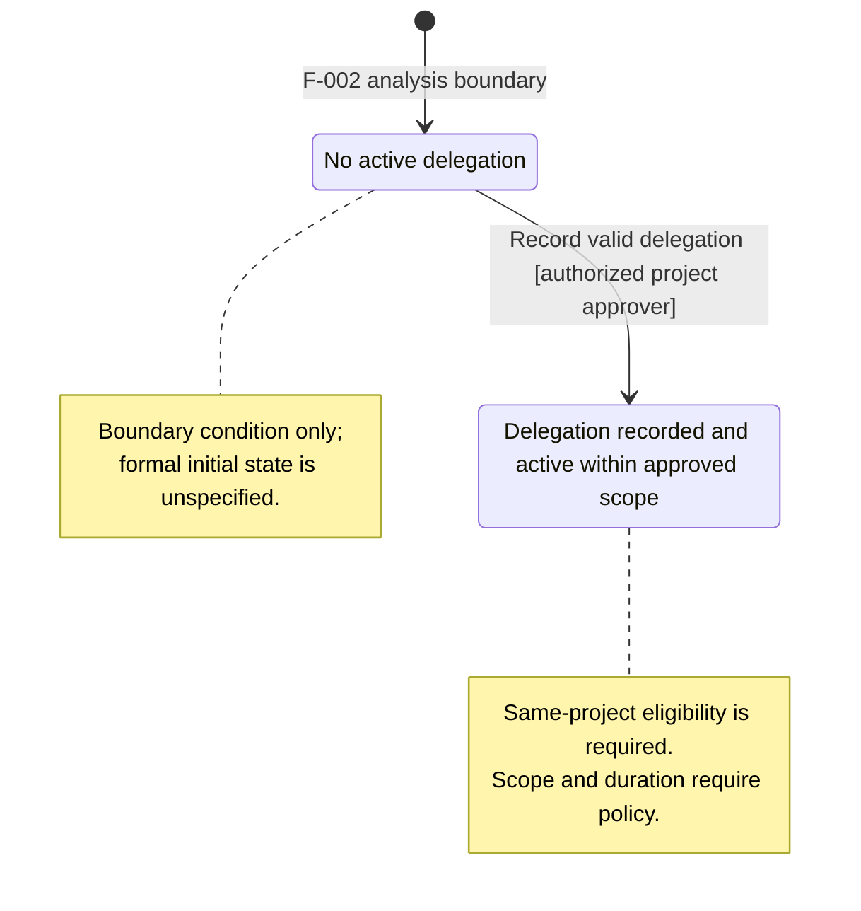

# F-002 Approval Workflow: State Lifecycle Analysis

**Status:** Provisional analysis; not an approved domain contract.
**Scenario:** backend+frontend (functional boundary; implementation stack is undecided).
**Scope:** State lifecycle only. This is not the complete domain model.
**Source status:** The F-002 specification and clarification summary state that the baseline and RFP are drafts with no formal approval evidence. The reviewed use cases are conditional on stakeholder decisions. Therefore, no transition below is represented as an approved policy.

## Applicability

State modeling is relevant to two concepts described in F-002: recording an approval outcome at a project or department level, and granting approval delegation. However, the sources do not establish a complete request lifecycle or delegation lifecycle. The model below records only the named outcomes and conditional transition behavior described in the current requirements and use cases.

The diagram entry `Eligible for decision` is the F-002 use-case precondition, not a newly defined request state. Approval outcomes are per-level. They do not imply an overall final approval. A diagram state without an outgoing transition means that no later transition is specified here, not that the state is terminal.

## Concepts and Lifecycle Bounds

| Stateful concept            | Initial state / condition                                                                                                  | Intermediate states                                                                                                     | Final states                                                                                                                                                         |
| --------------------------- | -------------------------------------------------------------------------------------------------------------------------- | ----------------------------------------------------------------------------------------------------------------------- | -------------------------------------------------------------------------------------------------------------------------------------------------------------------- |
| Approval outcome, per level | Eligible for a decision at that level (UC-002 precondition; entry lifecycle is owned by F-001)                             | Project-level approval recorded; department-level approval recorded; rejected outcome recorded (project rejection)      | Not established. A recorded outcome is observable, but terminality, subsequent request states, and overall final approval are unresolved.                            |
| Approval delegation         | No active delegation for the authority being considered (boundary condition only; a formal initial state is not specified) | No intermediate persisted state is specified. Validation/request steps in UC-005 do not establish a named domain state. | Not established. UC-005 describes a delegation being recorded and active within approved scope/duration; expiry, revocation, and termination states are unspecified. |

## State-Transition Table

Every transition below is supported by draft F-002 material and is conditional on stakeholder approval. “Forbidden” lists only denials or exclusions stated in the current use cases; it does not infer additional lifecycle rules.

| Concept          | From                                                    | To                                                   | Trigger / authorized actor                                                                              | Conditions and forbidden transitions                                                                                                                                                                                                                                         | Notifications or external actions                                                                                                                                 |
| ---------------- | ------------------------------------------------------- | ---------------------------------------------------- | ------------------------------------------------------------------------------------------------------- | ---------------------------------------------------------------------------------------------------------------------------------------------------------------------------------------------------------------------------------------------------------------------------- | ----------------------------------------------------------------------------------------------------------------------------------------------------------------- |
| Approval outcome | Eligible for decision at the project level              | Project-level approval recorded                      | Project approver records approval (F-002 US-002; UC-002)                                                | Actor must be authorized for the request and project scope; request must still be eligible. Deny unauthorized or stale/ineligible decisions.                                                                                                                                 | Outcome is exposed to the workflow under approved lifecycle rules. F-004 owns notifications/escalation; exact event, recipients, and timing are open.             |
| Approval outcome | Eligible for decision at the department level           | Department-level approval recorded                   | Department approver records approval (F-002 US-002; UC-002)                                             | Actor must be authorized for the request and department scope; request must still be eligible. Whether department approval is required, and when, is unresolved.                                                                                                             | Same unresolved F-004 handoff; do not infer final approval or export eligibility.                                                                                 |
| Approval outcome | Eligible for decision at the project level              | Rejected outcome recorded                            | Authorized project approver records rejection (F-002 US-002; UC-003)                                    | Request must be eligible and actor authorized. Required reason and follow-up are unresolved. No authority for a “responsible” actor, department approver, or delegate is inferred.                                                                                           | Outcome is exposed to lifecycle/notification processes under approved rules. F-004 notification details remain open.                                              |
| Delegation       | No active delegation for the authority being considered | Delegation recorded and active within approved scope | Authorized project approver requests delegation; system validates and records it (F-002 US-004; UC-005) | Proposed delegate must be eligible and in the same project (FR-029). Do not grant if the delegator lacks authority, delegate is ineligible/out of project, or membership cannot be verified. Scope, duration, allowed actions, and any confirmation remain policy-dependent. | Delegate may act only within granted scope/validity. Decision attribution is required only as settled by the audit policy; no external notification is specified. |

## Approval Outcome Diagram

This diagram is a per-level outcome view. It does not model the request's full lifecycle, approval ordering, parallelism, or a combined final state. No outgoing transition from a recorded outcome is asserted.

```mermaid
stateDiagram-v2
    [*] --> Eligible: F-002 decision boundary; request eligibility is defined outside F-002
    Eligible --> ProjectApproved: Record approval [authorized project approver]
    Eligible --> DepartmentApproved: Record approval [authorized department approver]
    Eligible --> Rejected: Record rejection [authorized project approver]

    state "Eligible for decision at this level" as Eligible
    state "Project-level approval recorded" as ProjectApproved
    state "Department-level approval recorded" as DepartmentApproved
    state "Rejected outcome recorded" as Rejected

    note right of Eligible
        Entry condition from UC-002.
        Not a newly defined request state.
    end note

    note right of ProjectApproved
        Recorded outcome is supported.
        Overall finality is unresolved.
    end note

    note right of DepartmentApproved
        Recorded outcome is supported.
        Requirement and order are unresolved.
    end note

    note right of Rejected
        Rejected outcome is supported.
        Follow-up and terminality are unresolved.
    end note
```

Source copy: [approval-outcome-state.mmd](../../../diagrams/approval-outcome-state.mmd).

## Delegation Diagram

This diagram shows only the grant described by UC-005. Expiry, revocation, amendment, and replacement are not modeled because the sources define no such transitions.



Source copy: [approval-delegation-state.mmd](../../../diagrams/approval-delegation-state.mmd).

## Business Rules Supported by Current Sources

- Project and department approval outcomes are recorded at their respective levels (FR-005, FR-006; UC-002).
- A project approver may record a rejected outcome (FR-007; UC-003); rejection reason and follow-up are not defined.
- Decision actors must be authorized for the request and scope. Unauthorized or stale/ineligible decisions are denied (UC-002, UC-003).
- A project approver's delegate must be in the same project (FR-029). Delegated action is limited to the approved scope and validity (UC-005); the policy values are open.
- “Assess” and “close” must not be treated as approval, rejection, or lifecycle transitions until their meaning and outcome are defined (FR-008, FR-009; UC-004).
- An approval at one level does not establish overall final approval. Required approvers, ordering, finality, and downstream export eligibility remain unresolved (F-002; Q-006).
- Notification and escalation behavior belongs to F-004; F-002 does not establish exact transition events, recipients, or timing (FR-021 to FR-023; Q-006, Q-018).

## Unresolved Questions

- Which project and department decisions are required, in what order or combination, and what constitutes final approval? (Q-006)
- What is the complete request lifecycle, including eligibility, rejection follow-up, correction/resubmission, cancellation, and terminal states? (F-001; Q-010)
- Who is the “responsible” approver, who assigns project/department approvers, and how are missing, multiple, or conflicting mappings handled? (Q-007, Q-014)
- Is “assess” distinct from approval, and is “close” distinct from rejection? What transitions and outcomes would either action create? (Q-008)
- Who may delegate, which authority/scope/duration may be delegated, and how are acceptance, revocation, expiry, overlap, and attribution handled? (Q-009)
- Does the approximately-50-person department coverage statement establish a rule? (Q-005)
- Which exact decisions trigger notifications, escalation, and downstream ServiceNow export? (Q-006, Q-018)
- What approved identity, role/action matrix, audit, privacy, and retention controls govern these transitions? (Q-021, Q-022)

## Source References

- [F-002 Approval and Delegation](../../../../specs/002-approval-and-delegation/requirements.md)
- [Clarification Summary](../../../../specs/clarification-summary.md)
- [UC-002 Record an Approval Decision](../../../legacy/specs/use-cases/UC-002-record-approval-decision.md)
- [UC-003 Reject a Project Request](../../../legacy/specs/use-cases/UC-003-reject-project-request.md)
- [UC-004 Assess or Close a Request](../../../legacy/specs/use-cases/UC-004-assess-or-close-request.md)
- [UC-005 Delegate Approval](../../../legacy/specs/use-cases/UC-005-delegate-approval.md)
- [UC-006 Resolve Approver Responsibility](../../../legacy/specs/use-cases/UC-006-resolve-approver-responsibility.md)
