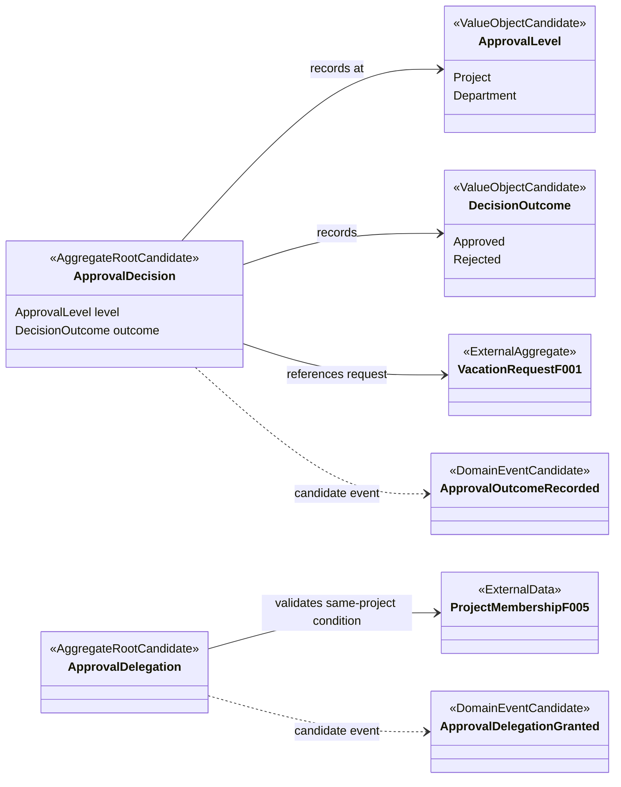
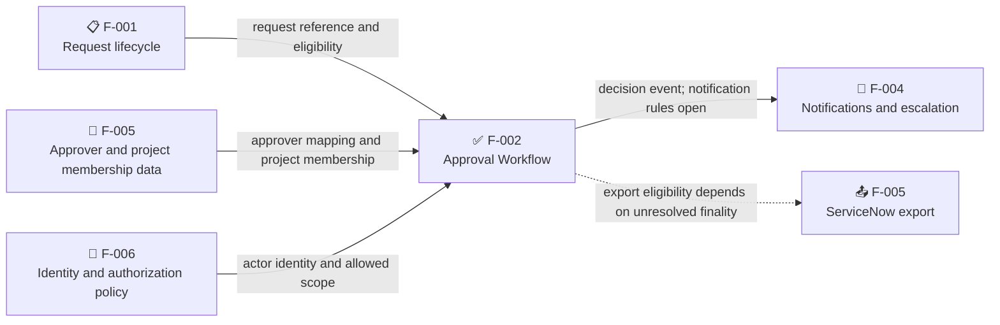

# F-002 Approval Workflow: Domain Model

**Model status:** Historical provisional candidate; superseded for the synthetic test project by [the approved test-profile model](../002-approval-and-delegation/requirements/data-model.md). This file remains a source-analysis record and is not the implementation contract.
**Bounded context:** Approval Workflow (candidate).
**Scope:** Domain concepts and boundaries for F-002 only. This is not implementation code or a complete domain model.

## Source and Approval Status

The current F-002 specification marks itself as draft and says the baseline/RFP have no formal approval evidence. The clarification summary likewise states that no reviewed source requirement or proposal is approved. The user stories and use cases are conditional on stakeholder decisions. Consequently, this document records a minimal model hypothesis supported by those artifacts; its proposed aggregate boundaries, ports, and event names require domain-owner review before implementation.

The only established decision outcomes are project-level approval, department-level approval, and project-level rejection. Approval order, required approvers, overall finality, rejection follow-up, delegation policy details, and authorization controls remain unresolved. No request lifecycle states are introduced here; that lifecycle belongs to F-001.

## Bounded Context

**Approval Workflow** owns the responsibility to expose in-scope requests for review, record authorized project- or department-level approval outcomes, record project rejection, and grant approval delegation when the approved policy permits it.

It does not own vacation-request lifecycle, identity/authentication, organizational membership source data, notification delivery, or external vacation export. The proposed boundary is a functional model only; context ownership and integration contracts have not been formally approved.

## Aggregates and Aggregate Roots

The aggregates below are candidate consistency boundaries inferred from the two distinct stateful responsibilities in the requirements/use cases. The sources do not define transaction boundaries, entity identifiers, or decision cardinality.

| Candidate aggregate/root | Responsibility supported by sources                                                                                                                                     | Boundary and unresolved details                                                                                                                                                                                                |
| ------------------------ | ----------------------------------------------------------------------------------------------------------------------------------------------------------------------- | ------------------------------------------------------------------------------------------------------------------------------------------------------------------------------------------------------------------------------ |
| `ApprovalDecision`       | Record an approved outcome at the applicable project or department level, or a rejected outcome by an authorized project approver (FR-005 to FR-007; UC-002 to UC-003). | Candidate root for a decision at a request/approval level. Whether decisions are separate records, updates, or grouped under a request is not specified. It references a request owned by F-001; it does not own that request. |
| `ApprovalDelegation`     | Record a project approver's delegation to an eligible person in the same project, within the approved scope (FR-029; UC-005).                                           | Candidate root because the grant changes who may act. Identity, scope shape, duration, activation/acceptance, revocation, and expiry lifecycle are not defined.                                                                |

No aggregate is asserted for approver assignment: source mapping and project membership are dependencies from F-005, with authority, ownership, and cardinality unresolved (Q-007, Q-014).

## Entities

| Candidate entity                        | Context ownership                         | Evidence and boundary                                                                                                                                                                                                        |
| --------------------------------------- | ----------------------------------------- | ---------------------------------------------------------------------------------------------------------------------------------------------------------------------------------------------------------------------------- |
| `ApprovalDecision`                      | F-002 candidate aggregate root            | A level-specific approved or rejected outcome is recorded. Whether it has independent identity or can be changed/replaced is open.                                                                                           |
| `ApprovalDelegation`                    | F-002 candidate aggregate root            | A delegation is recorded and permits a delegate to act within the granted policy scope. Its identity and lifecycle are open.                                                                                                 |
| Vacation request                        | F-001, external to this context           | Approval decisions refer to an existing eligible request. F-002 does not own its lifecycle or define its complete state machine.                                                                                             |
| Approver, delegate, project, department | External identity/organizational concepts | Actors and scopes are referenced by the use cases. Their identifiers, authoritative source, assignment ownership, and cardinality are not defined here; project/membership data depends on F-005 and access policy on F-006. |

No additional internal entities are established by the source material.

## Value Objects and References

| Candidate concept | Supported values or meaning                                   | Limitation                                                                                                                                                |
| ----------------- | ------------------------------------------------------------- | --------------------------------------------------------------------------------------------------------------------------------------------------------- |
| `ApprovalLevel`   | Project; department (FR-005 to FR-006).                       | Whether both levels apply to each request, and in what order, is unresolved.                                                                              |
| `DecisionOutcome` | Approved; rejected (FR-005 to FR-007).                        | Rejection is explicitly supported for the project approver. Department rejection is not established. This value does not mean the whole request is final. |
| Request reference | Identifies the F-001 request being considered.                | Identifier format and reference consistency rules are unspecified.                                                                                        |
| Project reference | Used to check the same-project delegation condition (FR-029). | Identifier format and project-membership source details are unspecified.                                                                                  |

Rejection reason, approver attribution, delegation scope, and validity period are deliberately not modeled as defined value objects: whether they are required and their precise semantics remain open (Q-008, Q-009, Q-022).

## Domain Services

| Candidate service                | Responsibility                                                                                                                | Boundary caveat                                                                                                                                                                               |
| -------------------------------- | ----------------------------------------------------------------------------------------------------------------------------- | --------------------------------------------------------------------------------------------------------------------------------------------------------------------------------------------- |
| Approver responsibility resolver | Resolve project approver responsibility from the approved project-to-approver source before review/decision (FR-028; UC-006). | The source and mapping depend on F-005. It is not established whether this belongs in F-002, F-005, or an application service; missing/multiple mapping behavior is unresolved.               |
| Delegation eligibility check     | Verify that the proposed delegate is eligible and in the same project before a grant (FR-029; UC-005).                        | Same-project eligibility is supported; who may delegate, other eligibility rules, scope, duration, and confirmation are not. It may be an aggregate invariant rather than a separate service. |

No separate approval-sequence or final-approval service can be defined until the workflow policy is clarified (Q-006).

## Domain Events

These are candidate event concepts corresponding to recorded outcomes/actions. They are not approved event names or message contracts.

| Candidate event             | Occurrence                                                                                                            | Consumers / external action                                                                                                                                     |
| --------------------------- | --------------------------------------------------------------------------------------------------------------------- | --------------------------------------------------------------------------------------------------------------------------------------------------------------- |
| `ApprovalOutcomeRecorded`   | An authorized approver records an approved outcome at one level, or an authorized project approver records rejection. | F-004 notification/escalation behavior depends on approved events; exact triggers, recipients, and delivery behavior are open (FR-021 to FR-023; Q-006, Q-018). |
| `ApprovalDelegationGranted` | The system records a valid delegation under an approved policy.                                                       | No notification is established by F-002. Attribution/audit requirements remain open (Q-009, Q-022).                                                             |

Do not emit or infer `RequestFinallyApproved`, `ApprovalCompleted`, or a ServiceNow export event from one recorded outcome: finality and required approvals are unresolved. F-005 INT-005/INT-006 make export dependent on all required approvals once those rules are defined.

## Invariants

| Invariant                                                                                                         | Source status                                                                                          |
| ----------------------------------------------------------------------------------------------------------------- | ------------------------------------------------------------------------------------------------------ |
| A decision is recorded only for an eligible request and an actor authorized for that request and approval scope.  | Conditional use-case rule (UC-002); the role/action matrix remains unapproved (SEC-002, Q-021).        |
| An approved outcome is recorded against its applicable project or department level.                               | Supported by FR-005, FR-006 and UC-002; level requirements and sequence remain open.                   |
| Rejection is available to an authorized project approver; no other role's rejection authority is inferred.        | Supported by FR-007 and UC-003; FR-010's “responsible” actor is unresolved.                            |
| A delegate must be eligible and in the same project, and can act only within the granted approved scope/validity. | Same-project condition is stated in FR-029; remaining delegation policy is unresolved (FR-030, Q-009). |
| A source mapping alone does not grant request visibility or decision authority.                                   | Stated in UC-006; authorization depends on the still-unapproved F-006 policy.                          |
| Assessment and close are not approval/rejection transitions unless stakeholders define them and their outcomes.   | FR-008/FR-009 and UC-004 explicitly leave their meanings open.                                         |
| A decision at one approval level is not by itself evidence of overall final approval.                             | The F-002 spec, UC-002, and Q-006 leave required levels and finality open.                             |

## Repository Ports

These are candidate ports implied by persistence and lookup responsibilities, not approved APIs or implementation interfaces.

| Candidate port                 | Purpose                                                                    | Open contract questions                                                                                                            |
| ------------------------------ | -------------------------------------------------------------------------- | ---------------------------------------------------------------------------------------------------------------------------------- |
| `ApprovalDecisionRepository`   | Load/record the decision outcome for a request and approval level.         | Decision identity/cardinality, duplicate submissions, concurrent decisions, and whether an outcome can be changed are unspecified. |
| `ApprovalDelegationRepository` | Record and retrieve delegations needed to validate a delegate's authority. | Scope, validity/expiry, revocation, overlap, and lookup semantics are unspecified.                                                 |

No F-002 repository port is proposed for vacation requests or approver assignments; those are external context data responsibilities.

## External Integration Ports

| Candidate port / boundary               | Direction and purpose                                                                                                                     | Owner / constraint                                                                                                   |
| --------------------------------------- | ----------------------------------------------------------------------------------------------------------------------------------------- | -------------------------------------------------------------------------------------------------------------------- |
| Request lifecycle port                  | F-002 reads a request reference and its current eligibility; decision outcomes are exposed to the request lifecycle under approved rules. | F-001 owns request lifecycle. Request contracts and state transitions are not specified by F-002.                    |
| Organizational approver/membership port | F-002 obtains project approver and same-project membership information.                                                                   | F-005, INT-003/INT-004. Source of truth, freshness, cardinality, and error behavior remain open (Q-014, Q-016).      |
| Identity and authorization boundary     | F-002 requires actor identity and authorization for request/scope/decision.                                                               | F-006. Identity provider and role/action matrix are draft/unresolved (SEC-001/SEC-002; Q-021).                       |
| Notification/escalation port            | Publish approved decision events for notification/escalation processing.                                                                  | F-004. Event triggers, recipients, and message behavior are unresolved (Q-006, Q-018).                               |
| Vacation export boundary                | Make only vacations meeting the eventually approved required-approval rule eligible for downstream export.                                | F-005, INT-005/INT-006. The required approval set and finality condition are unresolved; F-002 must not decide them. |

## Domain Model Diagram

The diagram shows candidate roots, supported value concepts, and ownership boundaries. Event names and aggregate boundaries remain provisional. External aggregates are references only; composition is not implied across contexts.

Standalone source: [F-002-approval-domain-model.mmd](../../docs/diagrams/F-002-approval-domain-model.mmd).

## Context and Port Diagram

Standalone source: [F-002-approval-context-boundaries.mmd](../../docs/diagrams/F-002-approval-context-boundaries.mmd).

## Unresolved Questions

- Which project and department approvals are required, and are they sequential, parallel, conditional, or mutually exclusive? What establishes final approval? (Q-006)
- Who is the “responsible” approver, who owns assignment, and how are missing, multiple, or conflicting approver mappings handled? (Q-007, Q-014)
- Is “assess” a distinct action, and is “close” distinct from rejection? What outcomes do they produce? (Q-008)
- Who may delegate; what authority, scope, duration, acceptance, revocation, expiry, and attribution rules apply? (Q-009)
- Is the department approver-coverage statement a binding rule, and how is the threshold measured? (Q-005)
- What identity, authorization, audit, privacy, and retention rules govern decisions and delegations? (Q-021, Q-022)
- Which decision outcomes trigger notifications, escalation, and ServiceNow export? (Q-006, Q-018)
- What source and freshness policy govern project membership and approver identity? (Q-014, Q-016)

## Source References

- [F-002 Approval and Delegation](../002-approval-and-delegation/requirements.md)
- [Clarification Summary](../clarification-summary.md)
- [F-002 state lifecycle analysis](../../docs/design/ddd/approval-workflow/state-lifecycle.md)
- [UC-002 Record an Approval Decision](../../docs/legacy/specs/use-cases/UC-002-record-approval-decision.md)
- [UC-003 Reject a Project Request](../../docs/legacy/specs/use-cases/UC-003-reject-project-request.md)
- [UC-004 Assess or Close a Request](../../docs/legacy/specs/use-cases/UC-004-assess-or-close-request.md)
- [UC-005 Delegate Approval](../../docs/legacy/specs/use-cases/UC-005-delegate-approval.md)
- [UC-006 Resolve Approver Responsibility](../../docs/legacy/specs/use-cases/UC-006-resolve-approver-responsibility.md)
